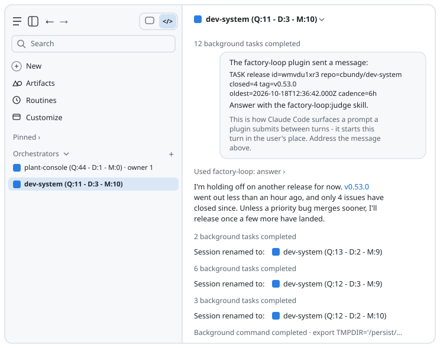
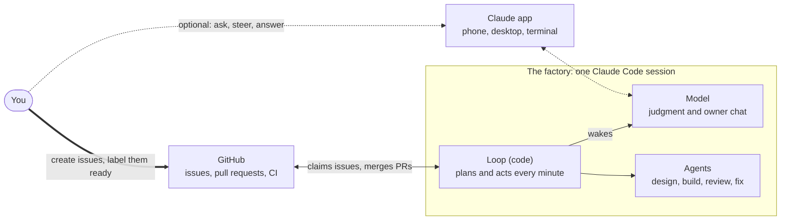
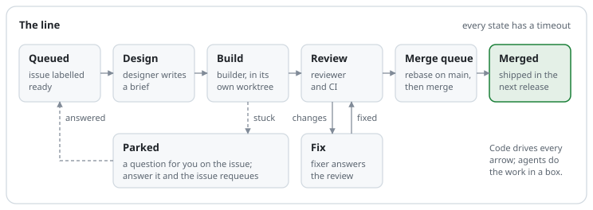

# dev-system

A software factory that runs inside a single Claude Code session.

[How it works](#how-it-works) · [Architecture](#architecture) · [Docs](#docs) · [Releases](https://github.com/cbundy/dev-system/releases)

  <picture>
    <source media="(prefers-color-scheme: dark)" srcset="docs/images/hero-dark.svg">
    
  </picture>
   
  The session title is a live status board: Q queued · D in flight · M merged

Label a GitHub issue `ready`. The factory designs it, builds it, reviews it and merges it. When it
needs a decision, it asks you - on the issue, or in the Claude app on your phone.

## Why it's different

Most agent factories put a program in charge and call Claude for each task. Others hand one model
the whole job and let it improvise. This one puts the program inside the Claude session.

- **Code runs the line.** Every minute, a loop reads the whole factory and acts from a fixed table:
  claim, start an agent, review, merge. Nothing routine waits on a model.
- **The model is kept for judgment.** It is woken to cut releases and to talk to you, and for
  little else.
- **The factory is a conversation.** It lives in a Claude session, so you reach it the way you
  reach any session: phone, desktop or terminal. Ask what it's doing, or steer it with
  `/factory pause`, `priority` or `drop`.

Writing issues is enough: the factory picks up anything labelled `ready` and comes back with a
merged pull request. The Claude app is there for when you want to talk to it.

## How it works

  <picture>
    <source media="(prefers-color-scheme: dark)" srcset="docs/images/pipeline-dark.svg">
    
  </picture>

- **Agents do the craft.** Designer, builder, reviewer and fixer each work in their own git
  worktree, and can't finish until the repo's lint and tests pass.
- **Surprises dealt with quickly.** A retry, then a triage agent with a fixed menu, then a
  question for you on the issue, with options to tick.
- **Everything is bounded.** Each state has a timeout, each retry a cap, and a breaker pauses new
  work when failures pile up.

<b>All <code>/factory</code> commands</b>

| Command | What it does |
|---|---|
| `status` | The last pass and the directives in force |
| `pause <N>` / `unpause <N>` | No action at all on an issue, though its claim still renews |
| `skip <N>` / `noskip <N>` | Never claim an issue |
| `priority <N...>` | Claim these first, in order |
| `only <N...>` | Claim only these, in order |
| `serial on\|off` | One issue in flight at a time |
| `new on\|off` | Off starts no new claims, designs or implementations |
| `resume <N>` | Release a hold on an issue or a run |
| `retry <N>` | Let an issue's exhausted actions run again |
| `drop <N>` | Abandon an issue and stop its agents |
| `note [<N>] <text>\|off` | An instruction the next agent prompts carry; a newer note replaces the older one, off clears it |
| `mode off\|observe\|act` | Switch the loop off, to watching only, or to acting |
| `trace on\|off` | Detailed per-pass timing records |

The full list, with every option, is in the [factory loop README](plugins/factory-loop/README.md#the-factory-command).

## Architecture

- **Event-sourced.** Each pass reads the factory from an append-only event log and GitHub; the
  loop's own records can be rebuilt from the events.
- **A pure planner.** `plan(state, config)` does no I/O and reads no clock, so recorded days of
  events can be replayed through it.
- **One state machine.** Every issue has one state with a timeout. Every step ends ok, not ok or
  unknown, and unknown has one path.
- **Code and model in one process.** The loop is a plugin inside the Claude session, and wakes the
  model only for judgment.
- **Idempotent actions.** Each action has a ledger key and checks what an earlier try did, so a
  retry never repeats work.
- **Approval follows the diff.** A review approves a git patch identity: rebasing onto main keeps
  it, any real change loses it.
- **Guards in the engine.** Hooks pin each agent to its worktree and refuse to let it stop while
  the repo's lint or tests fail.
- **Interventions are data.** Every unplanned step-in, by a person or the loop, is an event, so
  "untouched" is a query, not an opinion.

## What you need today

> [!NOTE]
> A factory runs in a Coder workspace built from this repo's `orchestrator-loop` template: the
> base image, a factory database and the factory-loop plugins.
>
> Where we're heading is simpler: install a plugin, type one command, and the session you're in
> becomes the factory. [Set up a factory](coder/dev-system/README.md#loop-orchestrator-workspace).

This evolved from my own setup, which relies heavily on Coder, a Docker swarm to run the
workloads, and a few other things. I hope to soon have the capacity to make it more general, and
I'm open to learning how someone else would want to run it.

- Each orchestrator (loop) runs as its own container, with a single persistent Claude Code session
  started on boot.
- It attaches to a single repository, which it clones. Agents run as sub-agents in this process,
  each given its own worktree.

## Docs

| Page | Read it for |
|---|---|
| [Factory loop](plugins/factory-loop/README.md) | Running and steering the loop, `/factory` commands |
| [Factory loop v2 spec](docs/factory-loop/v2/SPEC.md) | States, steps, failure handling, the merge queue |
| [Onboarding](docs/onboarding.md) | Making a repo a dev-system repo |
| [Architecture](docs/architecture.md) | Layers, versioning, the runtime map |
| [Base image](images/base/README.md) | The environment every workspace runs |
| [Factory database](docs/factory-db.md) and [metrics](docs/metrics.md) | Standing up the database; measuring the factory |
| [Releasing](RELEASING.md) | Cutting a release |
